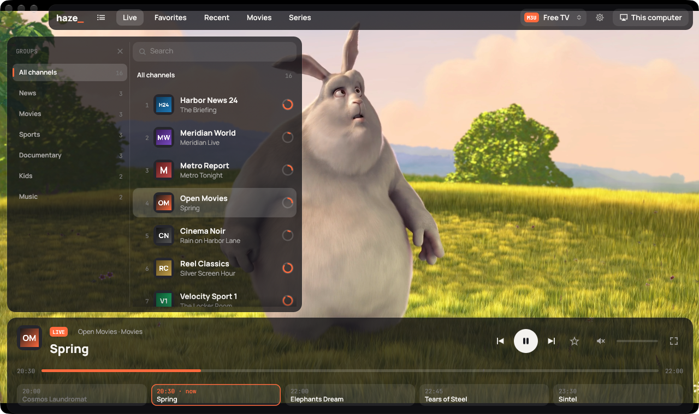
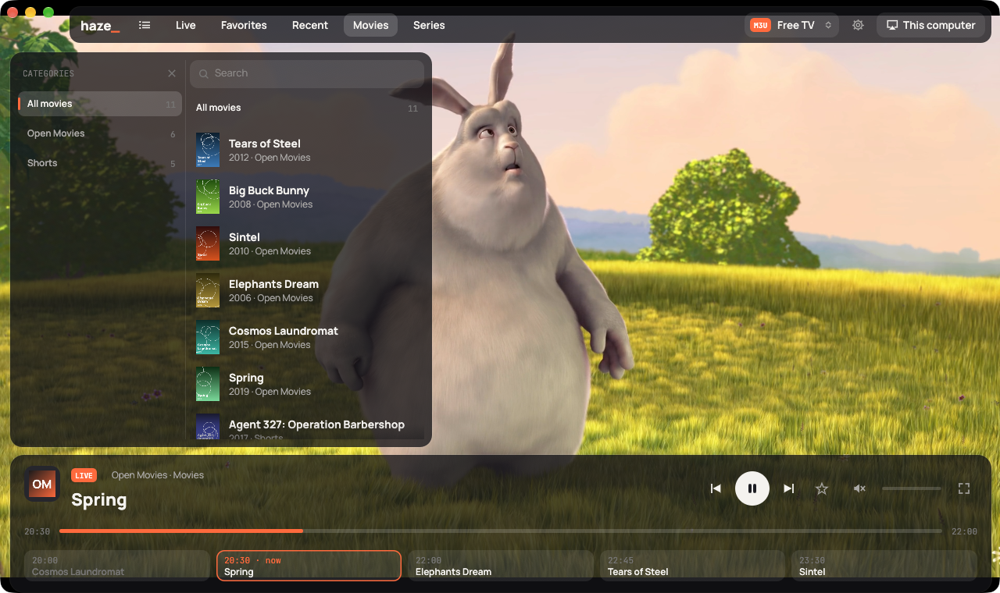
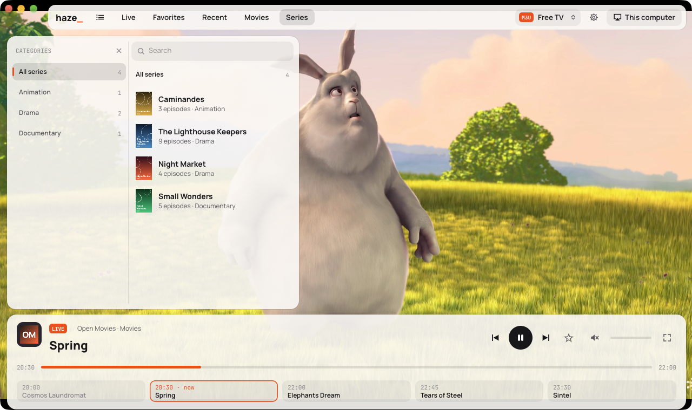
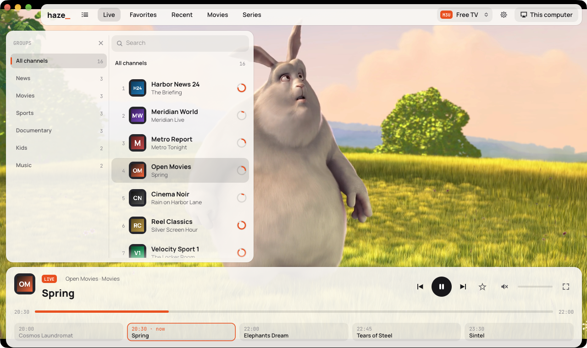

<p align="center"></p>

# haze

**A free and open source, ultra-lightweight desktop IPTV player written in Rust — M3U
playlists and Xtream Codes logins, a guide with catch-up, and AirPlay 2 sound built in.**

haze is dust's sibling: where [dust](https://github.com/domknez/dust) plays your music,
haze plays your channels. Dust in the air becomes haze — and the controls float over the
picture like haze over a screen, fading away while you watch.




No ads, no telemetry, no account with us: bring your own playlist or provider.

A single native process and a binary measured in megabytes, decoding through the
system's ffmpeg libraries — no browser engine, and no idle CPU: the window only
redraws when something on it changes.

## Sources

Add as many as you like and switch between them from the top bar. Each is checked
(its channels loaded) before it's saved.

| | |
|---|---|
| **M3U link** | a playlist URL (`.m3u` / `.m3u8`, `m3u_plus` links from providers), with the guide it names (`url-tvg`) or one you give |
| **M3U file** | a playlist on disk — or drop the file on the window |
| **Xtream Codes** | server, user name and password: live channels, the guide, the archive, movies and series from one login; account status and expiry in the source menu |

Playlists that carry a video library too are sorted out on their own: movies go to
*Movies*, episodes are gathered into series and seasons under *Series*, and only the
channels stay in the channel list. Xtream panels' `m3u_plus` links say what each entry
is (`…/movie/…`, `…/series/…`); in other playlists a group goes where most of it
looks like it belongs — episode tags (`S1 E2`, `1x02`, `Season 1 Episode 2`) make it
series, years (`Dune (2021)`) and video files make it movies. Where that guesses
wrong, right-click the group: *Show as channels / movies / series*, remembered for
the source.

Passwords are kept in the OS keychain (macOS Keychain, Windows Credential Manager,
Secret Service), never in the settings files.

## Features

**Watching**

- **Cinema look:** the picture fills the window; the top bar, the channel list and the
  bottom panel float over it as glass and fade out when the pointer is still. Dark and
  light themes (or follow the system)
- **Channel list:** logos, numbers, what's on now and how far along it is; groups,
  search, **favourites** (right-click a channel, or the star) and **recently watched**
- **Guide:** XMLTV (gzipped or not, read as a stream so huge provider guides stay
  light), the programme on now with its progress and a strip of what's next
- **Catch-up:** watch a programme that already aired from the strip, or the one on now
  *from the start* — Xtream archives, and M3U `catchup` (`default`, `append`, `shift`,
  `flussonic`, with `catchup-source` templates)
- **Movies and series:** the provider's video library by category, with posters;
  open a series for its episodes in season order, and the next one starts when an
  episode ends. Seek bar, ← → to skip 10 seconds
- **Zapping:** ↑ ↓ (or Page Up / Down) through the list on screen; the last channel
  comes back on the next start
- **Live channels reconnect** by themselves when the provider drops the stream
- **Audio tracks:** pick the language when a channel has several
- Full screen (F or double-click), Space to pause, M to mute, L for the channel list,
  ⌘F to search, ⌘1–5 for the tabs

**Listening anywhere**

- **AirPlay 2 and AirPlay 1** output, from dust: automatic discovery and a *Play sound
  on* picker showing each speaker's model — HomePod, Sonos, Apple TV, AirPort Express,
  shairport-sync and most AirPlay speakers
- **Lip sync on a speaker:** an AirPlay speaker plays sound about two seconds after it
  gets it; haze shows each frame when the speaker plays its sound, so picture and sound
  stay together
- **The speaker's buttons work** (volume, play/pause, next/previous channel), and so
  do media keys and the system's Now Playing controls

**Light on the machine**

- Decoding on the GPU (VideoToolbox on macOS, D3D11 on Windows, VA-API on Linux), with
  software decoding as the fallback
- Pictures go to the screen as YUV and are turned into colour by a shader: a third of
  the memory traffic of RGB, no colour conversion on the CPU
- HLS playlists open their best quality directly instead of probing every quality
- Packets wait compressed, not decoded, while the picture waits for a speaker
- Logos are shrunk to the size they're shown at and kept within a small budget

<p>
  
  
</p>



<sub>Screenshots use a made-up demo playlist; the picture is
[Big Buck Bunny](https://peach.blender.org/) (© Blender Foundation, CC BY 3.0).</sub>

## Install

haze links against ffmpeg's libraries (libavcodec, libavformat, libswscale,
libswresample) for demuxing and decoding.

```sh
# macOS
brew install ffmpeg pkg-config
# Debian / Ubuntu
sudo apt install libavcodec-dev libavformat-dev libswscale-dev libswresample-dev libavutil-dev \
  libasound2-dev libdbus-1-dev pkg-config clang

cargo build --release
./target/release/haze
```

## Under the hood

```
src/
  iptv/      playlists (m3u), provider logins (xtream), guides (xmltv), HTTP, time
  library.rs sources, catch-up URLs, favourites and recents
  media/     playback: demux → audio (drives the clock) and video (waits for it)
  output/    local sound card and AirPlay 1/2 (shared with dust)
  ui/        egui: the stage, glass panels, menus, the add-source dialog, GPU video
```

- **One clock, set by the sound.** The audio thread feeds the output as fast as it
  takes it and works out which moment is being *heard* (what was written, minus what the
  output still holds and its latency). The video thread decodes each frame just in time
  and shows it when the clock reaches it.
- **Settings** live in `~/Library/Application Support/haze/` (macOS),
  `%APPDATA%\haze\` (Windows) or `~/.config/haze/` (Linux): `settings.conf`,
  `sources.json`, `marks.json`. The log is `~/Library/Logs/haze/haze.log` on macOS.
- `haze probe <url> [seconds]` plays a stream without the window and reports what it is
  and how it plays (`HAZE_LOG=trace` adds ffmpeg's own messages);
  `HAZE_NO_HWACCEL=1` decodes in software.

## License

[MIT](LICENSE). Fonts: Manrope, JetBrains Mono, Inter and a Noto Sans Symbols 2 subset,
all under the SIL Open Font License (`assets/fonts/OFL-*.txt`).
